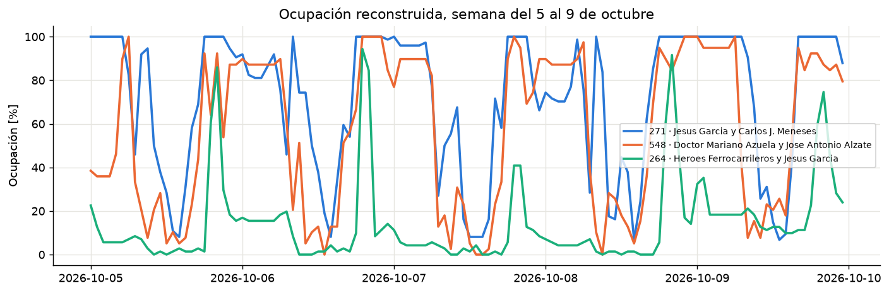
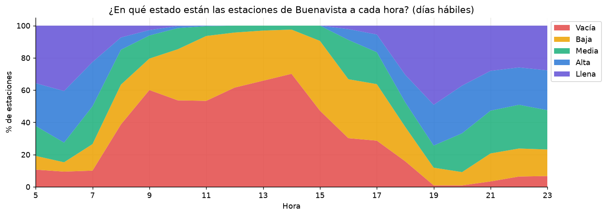
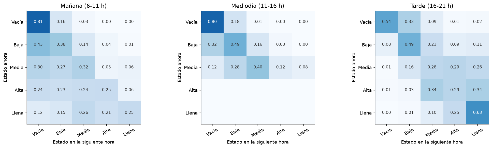
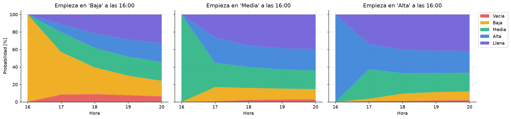

# Technical report — Ecobici Buenavista: data health check and a simple Markov chain

**Data:** Ecobici trips, September–October 2026 (3,098,318 trips, 6,584 bikes, 676 active stations) and the public Ecobici GBFS feed (dock capacity per station).
**Notebooks:** `health_check_sep_oct.ipynb` and `markov_buenavista_simple.ipynb`.

---

## 1. Summary

- **The trip data is clean.** There are no duplicate trips, no trips in both monthly files and no bike in two trips at once. Every station ID matches the catalog. What needs fixing is a handful of *analysis assumptions* in the EDA, not the data itself (section 2).
- **Dock capacity is available.** The EDA treated capacity C as unknown, but Ecobici's GBFS feed publishes it for all 677 stations. With capacity, and by following each bike from trip to trip, I reconstructed **how many bikes were at each station every hour**.
- **The model** is a Markov chain with 5 occupancy states (Empty, Low, Medium, High, Full), one-hour steps, and one transition matrix per time block (morning, midday, evening). It covers the 8 Buenavista stations, trained on September and tested on October.
- **Main results:**
  - Buenavista empties in the morning, stays empty at midday and fills up in the evening.
  - Station **271 is Full in 68% of evening hours**.
  - In the evening, a station that is "High" has a **34% chance of being Full one hour later**.
  - At 2–3 hours ahead the chain predicts the state about twice as well as "it will stay the same".
  - On average the cluster produces about 1.3–1.6 newly critical stations per hour. That points to **one or two trucks dedicated to Buenavista** at peak times, out of the 49 units Ecobici runs city-wide.

---

## 2. Data health check (September–October)

### 2.1 What is fine

| Check | Result |
|---|---|
| Duplicates (exact and bike + pickup time) | 0 |
| Trips in both monthly files | 0. Each file is cut by **arrival** date, so concatenating them is correct |
| Bike in two trips at the same time | 0 |
| Station IDs in trips missing from the catalog or GBFS | 0 (676 used, 677 in catalog; station 699 has no trips) |
| Pickups between 01:00 and 04:59 | 0, consistent with operating hours |
| Negative or zero durations | 0 |
| Double IDs like `271-272` | 12 stations. Each is **one** physical station with combined docks (GBFS confirms, e.g. 271 has 74 docks). Keeping the first number, as `datasetting` does, is correct |

### 2.2 What needs attention

| Issue | Size | Severity | Action |
|---|---|---|---|
| Dock capacity "not available" (EDA note) | It is in GBFS for all stations (3–75 docks, median 27) | **High** | Use `datasetting.cargar_capacidades()` (added) |
| Buenavista outage 14–16 Sep | 6 cluster stations with ~0 activity | **High** for the cluster | Exclude these days (`CIERRE_BUENAVISTA`) |
| Holiday 16 Sep (Independence Day) | −53% trips vs a normal Wednesday, but counted as a weekday in the EDA averages | Medium | Exclude `FERIADOS` from weekday averages |
| Rolling station closures in October | From 8 Oct, groups of 10–34 stations go dark for 1–2 weekdays each; ~250 stations affected in total | Medium | Detect station-days with ≤2 events and drop them from per-station averages |
| EDA's "Neto" (arrivals − pickups) read as accumulation | Station 271: +212 bikes/day from users, −212 bikes/day moved by operations | Medium | Read it as **rebalancing workload**, not saturation |
| Intraday "oscillation" metric | Averages weekdays that include the holiday and the outage | Medium | Recompute after excluding them, then divide by C |
| Durations | 447 under 1 min; 1,385 over 3 h; 61 over 24 h (some pickups date back to February) | Medium | The EDA's 1 min – 3 h filter is right for demand analysis |
| Ages | 41 trips with age > 90 (96–99 and 130); the EDA mentions only the 130s | Low | Set > 90 to missing in the user profile |
| Gender `?` | 2.5% of trips | Low | Report as "no data" |
| Catalog coordinates | Stations 21 and 22 share identical coordinates, giving 63 trips with 0 km distance | Low | Use GBFS coordinates |
| Catalog encoding | 34 station names lost ñ and accents | Low | Use GBFS names for display |
| End of period | Trips that start on 31 Oct and end on 1 Nov sit in the November file | Low | Ignore (Saturday night) |
| Station 84 | Inactive for 22 days, mostly in September | Low | Exclude those days for 84 |

### 2.3 A useful discovery: rebalancing is visible in the data

For **8.1% of consecutive trips** of the same bike, the bike starts at a different station from where it was left. That is not an error: operations moved it, by truck or for maintenance. That's roughly **4,100 bikes moved per day** across the city. Buenavista dominates:
- From station 271 alone, operations remove about **344 bikes per day**, almost all between 14:00 and 21:00.
- 266 is next at about 135 per day.

This is what makes it possible to reconstruct station inventory, which Ecobici does not publish.

---

## 3. The model

### 3.1 Cluster

The 8 Buenavista stations around the Buenavista train and Metrobús hub: **271, 266, 273, 548, 268, 547, 264, 176**. Capacities range from 31 to 75 docks and the stations are at most 0.8 km apart. I chose this cluster because it is the busiest node in the city and the one where operations work hardest.

### 3.2 How many bikes are at each station (reconstruction)

The trips are replayed per bike:
- If a bike arrives at station A and its next trip starts at A, it sat at A the whole time.
- If its next trip starts at a different station B, a truck moved it. The exact time is unknown, so it is assumed to leave A and appear at B halfway through the gap (at most 2 hours after arrival or before the next rental).
- Bikes that first appear after day 1 (back from maintenance, or new) are added 2 hours before their first rental.

This gives the number of bikes at the start of every hour, and occupancy is **L = bikes / docks**.

How good is the reconstruction?
- It never produces a negative inventory.
- It goes above capacity in 5.4% of station-hours, mostly at **271 (21% of hours)** and 266 (10%). In the evening peak those stations hold more bikes than docks, and the bikes are removed over time. Occupancy is capped at 100%, so those hours count as Full.

### 3.3 States, time step and days

| State | Occupancy |
|---|---|
| Empty | < 10% |
| Low | 10–35% |
| Medium | 35–65% |
| High | 65–90% |
| Full | ≥ 90% |

- **Step:** 1 hour.
- **Days:** 41 usable weekdays. That excludes the 16 Sep holiday and days with a cluster station offline (14–15 Sep), leaving 19 in September and 22 in October.
- **Train / test:** the chain is trained on September and tested on October.

The daily pattern is very strong:
- **Morning:** commuters ride out of Buenavista and the stations empty out. Some stations start the day Full, refilled overnight.
- **11:00–15:00:** 60–70% of the stations are Empty.
- **From 17:00:** commuters ride back to the train and the stations fill. At 19:00 half of them are Full.

Because the dynamics change so much during the day, **one matrix is not enough**. I estimate one per block: morning (6–11 h), midday (11–16 h) and evening (16–21 h).

### 3.4 Estimation

For each block, I count transitions from state *i* at hour *h* to state *j* at hour *h+1*, pooling the 8 stations. Then I divide each row by its total:

P[i, j] = (number of i → j transitions) / (number of hours that started in i)

This is the maximum-likelihood estimate of a homogeneous discrete-time Markov chain within each block. Each matrix uses 760 observed transitions (8 stations × 5 hours × 19 days).

How to read the matrices:
- **Evening:** Full is "sticky", with 63% staying Full the next hour. Medium and High push upward: High → Full is 34%.
- **Morning:** Empty is sticky (81%), and every other state drains toward Empty.
- **Midday:** stations are never High or Full, so those rows are blank. Empty stays Empty 80% of the time.

---

## 4. Results

### 4.1 Does it predict? (trained on September, tested on October)

Each prediction is the most likely state *n* hours ahead, taken from Pⁿ. It is compared with the naive forecast "same state as now".

| Block | Horizon | Markov accuracy | "Same as now" |
|---|---|---|---|
| Morning | 1 h | 43% | 52% |
| Morning | 2 h | 45% | 33% |
| Morning | 3 h | **50%** | 23% |
| Midday | 1 h | 66% | 66% |
| Midday | 3 h | 40% | 53% |
| Evening | 1 h | 41% | 48% |
| Evening | 2 h | 33% | 28% |
| Evening | 3 h | **38%** | 22% |

What this shows:
- **At 1 hour**, persistence wins or ties, because most stations stay in their state.
- **At 2–3 hours, in the morning and evening**, the chain is clearly better, because it knows the direction the stations move. That is the horizon that matters for dispatching a truck.
- **At midday** the chain does not beat persistence, because stations just sit Empty.
- 5 states means guessing at random scores 20%. The chain transfers from September to October without retraining.

### 4.2 What the chain says for operations

**Risk of being Full in the evening / Empty in the morning, given the current state:**

| | In 1 h | In 2 h | In 3 h |
|---|---|---|---|
| Evening, now **Medium** → P(Full) | 26% | 35% | 39% |
| Evening, now **High** → P(Full) | 34% | 40% | 42% |
| Evening, now **Full** → P(still Full) | 63% | 51% | 47% |
| Morning, now **Low** → P(Empty) | 43% | 57% | 62% |
| Morning, now **Medium** → P(Empty) | 30% | 47% | 57% |

**Expected hours until a critical state** (mean first-passage time, assuming the block's conditions continue):
- **Until Full, evening:** 3.7 h from High, 4.2 h from Medium.
- **Until Empty, morning:** 2.6 h from Low, 3.1 h from Medium.

**Long-run distribution per block** (π = πP). It summarises where each block "pushes" the stations:

| | Empty | Low | Medium | High | Full |
|---|---|---|---|---|---|
| Morning | 67% | 22% | 8% | 2% | 1% |
| Midday | 60% | 28% | 9% | 2% | 1% |
| Evening | 3% | 11% | 21% | 25% | **41%** |

**Which stations carry the problem (October, % of hours in the block):**

| Station | Morning Empty | Midday Empty | Evening Full | Evening Empty |
|---|---|---|---|---|
| 271 Jesús García / C. J. Meneses | 8 | 26 | **68** | 0 |
| 548 Dr. Mariano Azuela | 16 | 25 | 35 | 0 |
| 266 Jesús García / C. J. Meneses | 21 | 46 | 29 | 0 |
| 273 L. D. Colosio / J. García | 14 | 31 | 21 | 2 |
| 547 Dr. E. González Martínez | 27 | 49 | 20 | 4 |
| 268 L. D. Colosio / J. García | 44 | **82** | 18 | 21 |
| 176 J. García / L. D. Colosio | 35 | 51 | 18 | 15 |
| 264 Héroes Ferrocarrileros | **77** | **91** | 5 | **53** |

There are two kinds of problem stations:
- **Evening sinks:** 271, 548 and 266 fill up and need bikes **removed**.
- **Chronically empty:** 264 and 268 need bikes **added** almost all day.

### 4.3 A rough truck count (cluster only)

The 49 Ecobici units serve the whole city, so this is only what Buenavista alone would ask for:
- **Already critical:** about 3–4 of the 8 stations at any hour.
- **Newly critical:** from the matrices, about **1.3–1.6 stations per hour** (morning 1.55, midday 1.22, evening 1.33). Each needs a truck visit.

A truck that drives to a station, moves about 20 bikes and leaves takes on the order of 15–25 minutes, so it can make 2–4 visits per hour. That gives a rough sizing:
- **1 dedicated truck** can keep up with the newly critical stations.
- **A 2nd truck in the evening peak** would be needed to clear 271 and 266, which spend most of the evening Full.

This is an order-of-magnitude estimate, not an optimisation. Truck capacity and travel time are assumptions, not measured values.

---

## 5. Limitations

1. **Inventory is reconstructed, not measured.** Truck moves are placed at the midpoint of an unknown window, so the exact hour a station became Full or Empty can be off by up to about an hour. Hourly snapshots from the GBFS `station_status` feed would remove this uncertainty.
2. **Capacity is a snapshot** taken on 27 Nov 2026 and may differ slightly from September–October.
3. **One matrix per block is a simplification.** Within the evening block, 16:00 and 19:00 behave somewhat differently. Hour-specific matrices would be more accurate but need more data.
4. **The 8 stations are pooled into one matrix.** Station 264, which is almost always Empty, and 271, which fills every evening, follow the same matrix. The table in 4.2 shows how different they are.
5. **Little data:** 19 training days and 22 test days.
6. **Lost customers are not observable.** If a station is Empty, the trips that could not start are not in the data.

## 6. Recommended next steps

1. Start logging GBFS `station_status` every 5–15 minutes. That gives real inventory and removes limitation 1.
2. Fix the EDA assumptions in section 2.2: holiday, outage days, October closures, capacity, and how "Neto" is read.
3. Fit one chain per station type: an "evening sink" chain for 271, 548 and 266, and a "chronically empty" chain for 264 and 268.
4. Use the 2–3-hour Full/Empty risk from section 4.2 as a simple dispatch rule. For example, send a truck to any evening station that is High and still has a ≥ 40% chance of being Full within 2 hours.

---

### Files

| File | Content |
|---|---|
| `health_check_sep_oct.ipynb` | Data health check, executed, with a findings table |
| `markov_buenavista_simple.ipynb` | Inventory reconstruction and the Markov chain, executed |
| `datasetting.py` | Added `cargar_capacidades()`, `FERIADOS`, `CIERRE_BUENAVISTA`, `RUTA_OCTUBRE`, `RUTA_GBFS` |
| `data/gbfs_station_information_2026-11-27.json` | Ecobici GBFS snapshot with dock capacities |
| `reporte/figs/` | Figures used in this report |
